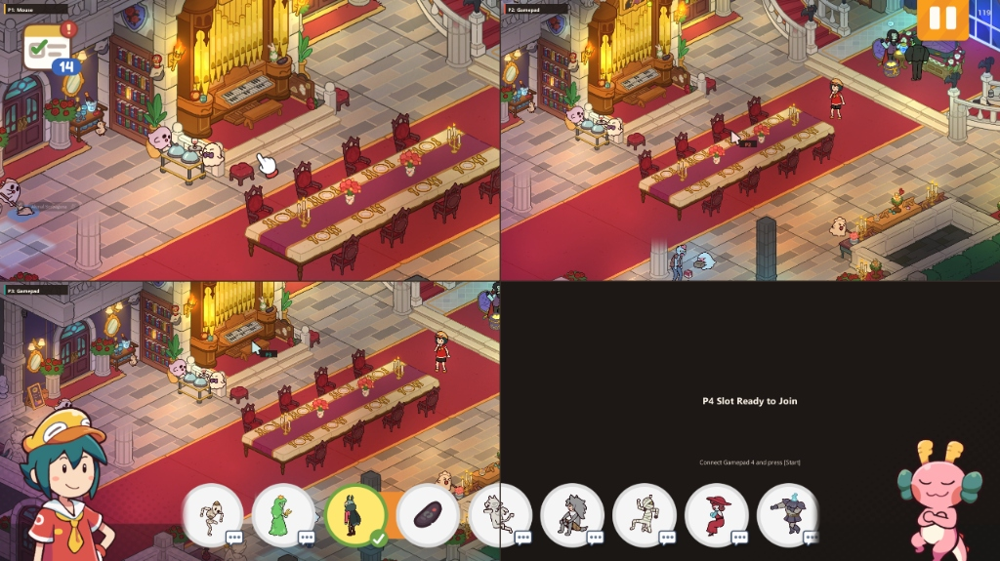

[English](../README.md) | [Bahasa Indonesia](README.id.md) | [ไทย](README.th.md) | **简体中文** | [繁體中文](README.zh-TW.md) | [日本語](README.ja.md) | [한국어](README.ko.md) | [Deutsch](README.de.md)

# Lost and Found Co. - 本地分屏合作模组 (Split-Screen Co-op)

基于 BepInEx 5 的 **《Lost and Found Co.》（失物招领有限公司）** Windows x64 本地分屏合作模组，支持 2 至 4 名玩家同屏游玩，具备独立视角与缩放、独立虚拟光标、设备输入隔离、过场自动全屏切换及多语言模组界面。

> **已测试游戏版本**: **Lost and Found Co. Patch 1.2.2**（2026 年 10 月 27 日，Steam Build `26480281`，Unity `6000.0.84f1`，Windows x64）。只要游戏内部的相机、输入与光照类未发生破坏性改动，后续小版本更新通常均可兼容。



## 主要功能

- **支持 2 至 4 人本地分屏**:
  - **2 人模式**: 支持左右分屏与上下分屏，随时按 `F11` 切换。
  - **3 人模式**: 2x2 网格并在右下角显示 P4 等待加入卡片。
  - **4 人模式**: 完整四宫格分屏。
- **输入隔离与混合设备**:
  - 默认 P1 使用 **鼠标 + 键盘**，已连接的手柄自动分配给 P2-P4；按 `F7` 可切换为手柄 1 控制 P1。
  - 按任意手柄的 `Start` 键即可中途加入；单人无额外手柄时也可按 `F6` 开启 P2 键盘测试模式（`IJKL` 光标、方向键移动镜头、`U`/`O` 缩放、`Enter` 点击）。
- **独立镜头与 2D 点击交互**:
  - 每位玩家拥有独立的 `WorldCamera`，可分别平移、缩放及触发 `Physics2D` 点击拖拽（按住 `Y` 或 `L3` 可临时解锁全屏光标操作 HUD 与任务清单）。
- **过场动画自动全屏 (`AutoFullscreenOnCutscene`)**:
  - 在剧情过场、拍照演出、对话锁镜或楼层切换时自动恢复全屏显示，结束后自动切回分屏。
- **兼容 URP HDR Bloom 与 2D 光照**:
  - 保留 HDR 光效（`RGB111110Float`）并将 `FunkyCode` SmartLighting2D 光照图同步至每个玩家视口。
- **界面自动多语言**:
  - 随游戏语言设置自动切换（支持 `en`、`th`、`zh-CN`、`zh-TW`、`ja`、`ko`、`de`，并在安装印尼语本地化模组时支持 `id`，同时预置了 `fr`、`es-ES`、`it`、`ru`、`sv-SE`、`tr`、`pt-BR`、`vi` 词条），并自动调用对应语言的 Windows 系统字体（如微软雅黑、正黑体、Yu Gothic、Leelawadee UI 等）。

## 我的其他模组与兼容性说明

我还开发了配套的 **[Lost and Found Co. 印尼语本地化模组](https://github.com/AkmalHidayat/LostAndFound-IndonesianMod)**（`LostAndFound_Indonesian.dll` / `com.teteh.lostandfoundco.indonesian`，已将 16,718 条文本翻译更新至 **Patch 1.2.2**；后续新版本若新增关卡需等待词典更新），与本模组可安全共存：

- 当游戏语言设为印度尼西亚语时，分屏控制面板 `F10`、角落角标、P4 等待栏及提示条会自动切换为一致的印尼语界面文本。
- 分屏布局快捷键仅绑定至 `F11`，保留 `F9` 给印尼语模组用于词典热重载，互不冲突。
- 自动安装器 `Install_SplitScreenCoop.bat` 与卸载器 `Uninstall_SplitScreenCoop.bat` 不会覆盖或删除已安装的代理 DLL 或其他模组文件。

---

## 安装方式

### 方式一：自动安装 ZIP（推荐）

1. 从 [GitHub Releases](https://github.com/AkmalHidayat/LostAndFound-SplitScreenCoop/releases) 下载 **`LostAndFound-SplitScreenCoop-v1.0.4-AutoInstall.zip`**。
2. 将压缩包内所有文件解压到游戏根目录（与 `Lost and Found Co.exe` 同级）。
   - Steam 默认路径示例: `C:\Program Files (x86)\Steam\steamapps\common\Lost and Found Co`
3. 双击运行 **`Install_SplitScreenCoop.bat`**（安装脚本界面为英文）。
   - 若尚未安装 BepInEx 5，脚本会使用空闲的 Unity Doorstop 代理（`winhttp.dll`）完成安装，绝不覆盖现有文件。
   - 若已安装 BepInEx 5 或其他模组，脚本将保留原有加载器，仅放入 `BepInEx\plugins\LostAndFound_SplitScreenCoop.dll`。
4. 通过 Steam 正常启动游戏。

卸载时只需运行游戏目录中的 **`Uninstall_SplitScreenCoop.bat`**，脚本会校验 SHA-256 哈希值后安全移除；若存在其他插件，会自动保留 BepInEx。

### 方式二：手动拖放完整目录 ZIP

适合希望手动放置文件而不运行 `.bat` 安装脚本的玩家：

1. 在 [GitHub Releases](https://github.com/AkmalHidayat/LostAndFound-SplitScreenCoop/releases) 下载 **`LostAndFound-SplitScreenCoop-v1.0.4-Manual.zip`** 并解压到临时文件夹。
2. 根据您的游戏目录情况放置文件：
   - **纯净游戏目录（尚未安装 BepInEx）**：将 `winhttp.dll`、`doorstop_config.ini` 和 `BepInEx` 文件夹直接拖放到 `<游戏目录>`（与 `Lost and Found Co.exe` 同级）。
   - **已安装 BepInEx 5 或印尼语本地化模组**：只需将 `BepInEx\plugins\LostAndFound_SplitScreenCoop.dll` 放入 `<游戏目录>\BepInEx\plugins\`（不要覆盖现有的 `winhttp.dll` 或 `doorstop_config.ini`）。

### 方式三：从源码自行编译

详细步骤请查看 [docs/BUILDING.md](BUILDING.md)：

```powershell
git clone https://github.com/AkmalHidayat/LostAndFound-SplitScreenCoop.git
cd LostAndFound-SplitScreenCoop
powershell -ExecutionPolicy Bypass -File ".\scripts\build.ps1" -Deploy
```

---

## 按键与手柄控制

| 快捷键 | 说明 |
| --- | --- |
| `F8` | 开启 / 关闭分屏合作模式 |
| `F11` | 切换双人分屏布局（左右 / 上下） |
| `F7` | 切换 P1 输入方式（键鼠 / 手柄 1） |
| `F10` | 打开 / 关闭合作控制面板 |
| `F6` | 开启 / 关闭 P2 键盘测试（`IJKL` 光标、方向键移镜、`U`/`O` 缩放、`Enter` 点击） |

手柄控制（P2-P4，以及开启手柄模式的 P1）：`左摇杆` 移动光标，`右摇杆` 移动镜头，`LT`/`LB` 与 `RT`/`RB` 缩放，`A` 键点击/拖拽，按住 `Y` 或 `L3` 操作全屏 HUD/任务清单，按 `R3` 重置镜头，按 `Start` 加入游戏。

---

## 配置与许可

- 首次运行后会生成配置文件 `<游戏目录>\BepInEx\config\com.teteh.lostandfound.splitscreencoop.cfg`（可在 `[UI]` 下将 `UiLanguage` 由 `Auto` 改为指定语言代码）。
- 模组源码采用 [MIT License](../LICENSE) 授权（Copyright (c) 2026 AkmalHidayat）；随自动安装包附带的 BepInEx 5 / HarmonyX / Unity Doorstop 组件许可说明见 [docs/THIRD_PARTY_NOTICES.md](THIRD_PARTY_NOTICES.md)。

> **免责声明**: 本模组为社区非官方作品，与游戏开发商 **Bit Egg Inc.** 无关。
