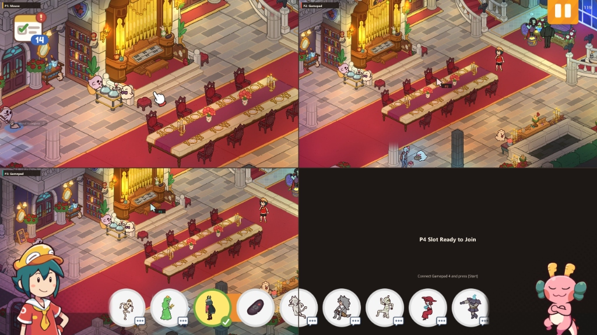

[English](../README.md) | [Bahasa Indonesia](README.id.md) | [ไทย](README.th.md) | [简体中文](README.zh-CN.md) | **繁體中文** | [日本語](README.ja.md) | [한국어](README.ko.md) | [Deutsch](README.de.md)

# Lost and Found Co. - 本地分割畫面合作模組 (Split-Screen Co-op)

基於 BepInEx 5 的 **《Lost and Found Co.》** Windows x64 本地分割畫面合作模組，支援 2 至 4 位玩家同畫面遊玩，提供獨立視角與縮放、獨立虛擬游標、裝置輸入隔離、過場自動全螢幕切換與多語系模組介面。

> **已測試遊戲版本**: **Lost and Found Co. Patch 1.2.2**（2026 年 10 月 27 日，Steam Build `26480281`，Unity `6000.0.84f1`，Windows x64）。只要遊戲內部的相機、輸入與光照類別沒有大幅變動，後續小幅更新通常可正常相容。



## 主要功能

- **支援 2 至 4 人本地同玩**:
  - **2 人模式**: 支援左右分割與上下分割，可隨時按 `F11` 切換。
  - **3 人模式**: 2x2 格線並於右下角顯示 P4 等待加入卡片。
  - **4 人模式**: 完整四格分割畫面。
- **裝置輸入隔離與混合遊玩**:
  - 預設 P1 使用 **滑鼠 + 鍵盤**，已連接的控制器自動指派給 P2-P4；按 `F7` 可切換為控制器 1 操控 P1。
  - 按下任一控制器的 `Start` 鍵即可熱加入合作；或按 `F6` 開啟 P2 鍵盤測試模式（`IJKL` 游標、方向鍵移動鏡頭、`U`/`O` 縮放、`Enter` 點擊）。
- **獨立鏡頭與 2D 物件點擊**:
  - 每位玩家皆有獨立 `WorldCamera`，可各自平移、縮放並執行 `Physics2D` 點擊與拖曳（按住 `Y` 或 `L3` 可暫時解鎖全螢幕游標操作 HUD 與待辦清單）。
- **過場自動切換全螢幕 (`AutoFullscreenOnCutscene`)**:
  - 進入劇情過場、拍照事件、對話鎖定視角或切換樓層時自動恢復全螢幕，結束後自動返回分割畫面。
- **完整支援 URP HDR Bloom 與 2D 光照**:
  - 使用 `RGB111110Float` 保留 HDR 光暈並同步 `FunkyCode` SmartLighting2D 光照貼圖至所有玩家鏡頭。
- **模組介面自動多語系**:
  - 自動跟隨遊戲設定語系（`en`、`th`、`zh-CN`、`zh-TW`、`ja`、`ko`、`de`，安裝印尼語模組時支援 `id`，並預置 `fr`、`es-ES`、`it`、`ru`、`sv-SE`、`tr`、`pt-BR`、`vi`），並自動套用 Windows 對應系統字型（微軟正黑體、微軟雅黑、Yu Gothic、Leelawadee UI 等）。

## 我製作的其他模組與相容性

我也製作了配套的 **[Lost and Found Co. 印尼語本地化模組](https://github.com/AkmalHidayat/LostAndFound-IndonesianMod)**（`LostAndFound_Indonesian.dll` / `com.teteh.lostandfoundco.indonesian`，16,718 條詞庫已更新至 **Patch 1.2.2**；日後遊戲更新若有新增關卡須待詞庫同步更新），可與本模組安全共存：

- 遊戲啟用印尼語時，合作面板 `F10`、角落標籤、P4 待命卡片與提示訊息會自動切換為印尼語。
- 版面切換快捷鍵僅使用 `F11`，保留 `F9` 供印尼語模組進行詞庫熱重載。
- 安裝程式 `Install_SplitScreenCoop.bat` 與移除程式 `Uninstall_SplitScreenCoop.bat` 皆不會覆蓋或刪除既有的代理載入器與其他外掛。

---

## 安裝方式

### 方法一：自動安裝 ZIP（推薦）

1. 前往 [GitHub Releases](https://github.com/AkmalHidayat/LostAndFound-SplitScreenCoop/releases) 下載 **`LostAndFound-SplitScreenCoop-v1.0.4-AutoInstall.zip`**。
2. 將 ZIP 內所有檔案解壓縮至 **Lost and Found Co.** 遊戲主資料夾（與 `Lost and Found Co.exe` 同層）。
3. 點兩下執行 **`Install_SplitScreenCoop.bat`**（指令碼介面為英文）。
   - 若尚未安裝 BepInEx 5，安裝程式會使用未佔用的 Unity Doorstop 代理（`winhttp.dll`）自動部署，絕不覆蓋原有檔案。
   - 若已安裝 BepInEx 5 或其他模組，則保留原有載入器，僅複製 `BepInEx\plugins\LostAndFound_SplitScreenCoop.dll`。
4. 透過 Steam 啟動遊戲即可。

移除時請執行遊戲資料夾內的 **`Uninstall_SplitScreenCoop.bat`**；腳本會先比對 SHA-256 雜湊值再刪除，且若偵測到其他外掛模組會保留 BepInEx。

### 方法二：手動拖放完整目錄 ZIP

適合希望手動複製檔案、不執行 `.bat` 安裝指令碼的玩家：

1. 自 [GitHub Releases](https://github.com/AkmalHidayat/LostAndFound-SplitScreenCoop/releases) 下載 **`LostAndFound-SplitScreenCoop-v1.0.4-Manual.zip`** 並解壓縮至暫存資料夾。
2. 依照遊戲資料夾狀態放入檔案：
   - **全新遊戲資料夾（尚未安裝 BepInEx）**：將 `winhttp.dll`、`doorstop_config.ini` 與 `BepInEx` 資料夾直接拖放進 `<遊戲資料夾>`（與 `Lost and Found Co.exe` 同層）。
   - **已安裝 BepInEx 5 或印尼語本地化模組**：只須將 `BepInEx\plugins\LostAndFound_SplitScreenCoop.dll` 放進 `<遊戲資料夾>\BepInEx\plugins\`（請勿覆蓋既有的 `winhttp.dll` 或 `doorstop_config.ini`）。

### 方法三：從原始碼自行建置

完整教學請見 [docs/BUILDING.md](BUILDING.md)：

```powershell
git clone https://github.com/AkmalHidayat/LostAndFound-SplitScreenCoop.git
cd LostAndFound-SplitScreenCoop
powershell -ExecutionPolicy Bypass -File ".\scripts\build.ps1" -Deploy
```

---

## 快捷鍵與控制器操作

| 按鍵 | 功能 |
| --- | --- |
| `F8` | 開啟 / 關閉分割畫面合作 |
| `F11` | 切換雙人分割版面（左右 / 上下） |
| `F7` | 切換 P1 輸入（滑鼠 + 鍵盤 / 控制器 1） |
| `F10` | 開啟 / 關閉合作控制面板 |
| `F6` | 切換 P2 鍵盤測試模式（`IJKL` 游標、方向鍵移動鏡頭、`U`/`O` 縮放、`Enter` 點擊） |

控制器操作（P2-P4，以及切換為控制器 1 的 P1）：`左搖桿` 移動游標，`右搖桿` 移動鏡頭，`LT`/`LB` 與 `RT`/`RB` 縮放，`A` 鍵點擊/拖曳，按住 `Y` 或 `L3` 解鎖全螢幕以操作 HUD/待辦清單，按 `R3` 重設鏡頭，按 `Start` 加入。

---

## 設定檔與授權條款

- 設定檔位於 `<遊戲資料夾>\BepInEx\config\com.teteh.lostandfound.splitscreencoop.cfg`（可修改 `[UI]` 下的 `UiLanguage`）。
- 模組原始碼依 [MIT License](../LICENSE) 授權（Copyright (c) 2026 AkmalHidayat）；自動安裝包內含之 BepInEx 5 / HarmonyX / Unity Doorstop 授權請見 [docs/THIRD_PARTY_NOTICES.md](THIRD_PARTY_NOTICES.md)。

> **免責聲明**: 本專案為非官方社群模組，與開發商 **Bit Egg Inc.** 無任何關聯。
